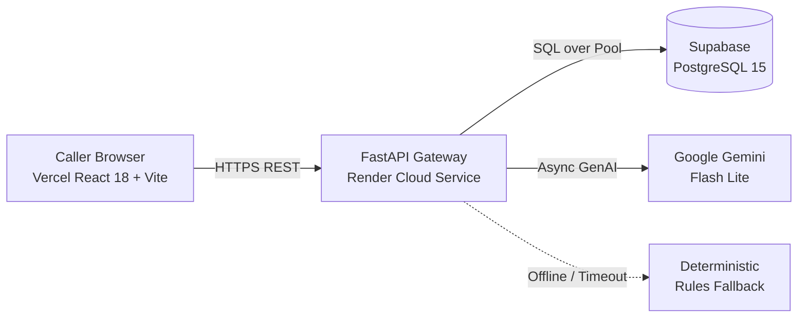

# Spindle · Technical Architecture & Design Document

Built for the **Forward Deployed Engineer (FDE)** role at **DeepThought CultureTech Ventures Pvt Ltd** (Sainikpuri, Hyderabad).

---

## 1. System Overview

Spindle is an enterprise-grade, low-latency cold call execution cockpit designed for callers contacting Indian SME manufacturing leadership.



### Core Design Goals
1. **Zero Cognitive Friction:** Indian SME calls average **93.5 seconds**. Callers cannot look away or type complex entries. One tap logs the stage; one box captures quotes.
2. **Sub-second Response:** Model interventions (AI Cue) return in under 500ms to preserve human conversation tempo.
3. **Audit Trail Integrity:** Prevents CRM corruption caused by human outcome mislogging (`T010`, `T099`, `T066`, `T084`).

---

## 2. Telephony State Machine

The call follows an 8-stage state machine derived from Reading 1 and verified against 100 transcripts:

```
[1. Opening] ──> [2. Purpose] ──> [3. Permission] ──> [4. Their Business]
      │               │                  │                   │
   Wrong Person     Hiring?         Call Later?          HQ Decides?
   Switchboard      Where got?      WhatsApp First?      Job Work?
      │               │                  │                   │
      v               v                  v                   v
[8. Close & Consistency Audit] <── [7. Next Step] <── [6. Objection] <── [5. Their Need]
```

---

## 3. Storage Layer: Supabase PostgreSQL (`schema.sql`)

- **Normalized Stage Progression:** `call_stages` enforces `UNIQUE(call_id, stage_number)`. When a caller re-taps a stage, it updates in place rather than creating duplicate row entries.
- **Analytical Views:**
  - `v_stage_dropoff`: Computes live aggregate count of calls ending at stages 1 through 8.
  - `v_outcome_distribution`: Real-time breakdown of outcomes across positive, neutral, and negative buckets.
- **Security:** Row Level Security (RLS) is active; queries utilize service-role authentication proxying through FastAPI to prevent credential exposure in client code.

---

## 4. LLM Strategy: Google Gemini Flash Lite

- **Provider:** Google Gemini via Google AI Studio free tier.
- **Active Model:** `gemini-flash-lite-latest`.
- **Latency Optimization:** Temperature locked at `0.2` and `max_output_tokens=80` for deterministic, sub-second spoken cues.
- **Fail-Safe Mechanism:** If network errors or quota limits occur, the system falls back to deterministic rule-based evaluation without crashing. The client transparently reflects `source: "llm"` or `source: "rules"`.

---

## 5. Enterprise CSV Export

CRM managers and sales leaders can download complete call registries either via the UI's **Export CSV** button or directly from the API endpoint:
```http
GET /api/calls/export.csv
Content-Type: text/csv
Content-Disposition: attachment; filename=spindle-calls.csv
```
