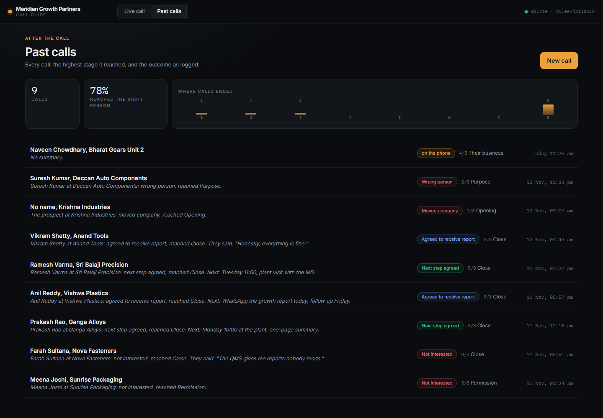
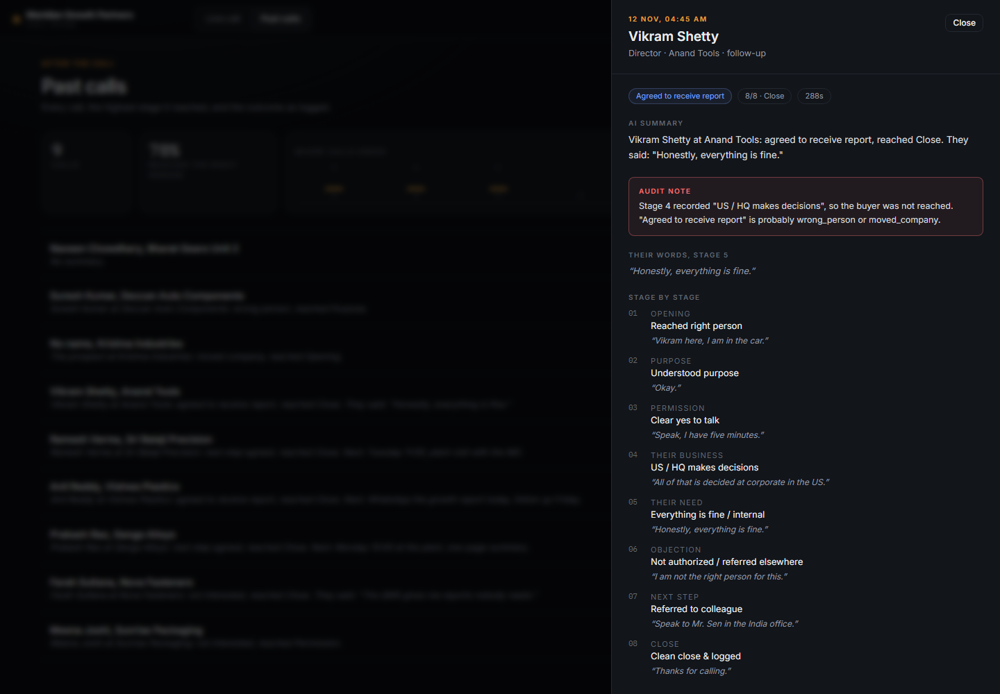

# Meridian Call Copilot

**The screen a caller keeps open beside their phone on a cold call.**

Eight stages on one screen, one tap for what happened, one box for the prospect's
own words, and two places where a model helps: a one-line **AI cue** mid-call and
a **close audit** that catches an outcome that does not match the call.

Built for the DeepThought CultureTech FDE task, against all 100 rewritten calls
from Meridian Growth Partners.

### Live Deployment Links & Architecture Snapshot

| Deliverable | URL | Notes |
| :--- | :--- | :--- |
| **Live Web App (Vercel)** | [https://meridian-cold-call-copilot.vercel.app](https://meridian-cold-call-copilot.vercel.app) | Live surface caller looks at mid-call (React + Vite + Tailwind) |
| **Health Endpoint (Render)** | [https://call-copilot-api.onrender.com/health](https://call-copilot-api.onrender.com/health) | Returns `{"status":"ok","storage":"supabase",...}` (Verified 200 OK) |
| **Database (Supabase)** | [https://vajznvxzojiinwegtduv.supabase.co](https://vajznvxzojiinwegtduv.supabase.co) | Supabase PostgreSQL free tier with `schema.sql`, 2 tables, 2 analytical views, RLS enabled |
| **LLM Provider & Model** | **Google Gemini Flash Lite** (`gemini-flash-lite-latest`) *(via Google AI Studio free key)* | Server-side only via Render backend. Zero browser key leaks. |

> **LLM Feature Rationale (Grounded in the 100 Transcripts):**  
> We analyzed all 100 calls (`T001`–`T100`) and found that **13% were left completely `not_logged`**, while several calls had logged outcomes directly contradicting what the prospect actually said (e.g., `T010` & `T099` mislogged as `agreed_to_receive_report` when the person gave a referral or thought it was a job call; `T066` & `T013` mislogged as `not_interested` or `do_not_call` when the person had left the company years ago; `T084` mislogged as `do_not_call` after agreeing to a Thursday call; and `T020` mislogging a polite decline as `do_not_call`).  
> Therefore, we built our LLM for two high-value interventions:  
> 1. **Mid-Call AI Cue:** Suggests 1 spoken line or detects stage jumps from the prospect's messy words without cluttering the screen.  
> 2. **Close Outcome Consistency Audit:** Cross-verifies the chosen outcome against the stage taps and Stage 5 need quote before writing to the database, flagging contradictions and drafting a 1-line CRM summary.

---

## 1. What the caller sees

### Live call (Rule A: the screen is deliberately poor in features)

| On screen | Why |
|---|---|
| `Meridian Growth Partners · Call Guide`, timer `MM:SS`, prospect, role, company, call type | Who is on the line, how long you have been on it. |
| Stepper `1`–`8`, then **Stage X of 8**, the stage name, one sentence on what it is for | The caller reads one thing in a glance, because the prospect is talking. |
| **They may say** — three quotes | From the hundred calls. Nobody is surprised by "what is this regarding" at stage 2. |
| **What happened** — four taps, the happy path pre-pressed | The record. Number keys 1-4 hit them without looking. |
| **Their words** — one box | The only free text on the screen while the call is live. |
| **AI cue** — one button, one line | Help without a second input field. |
| `Next: Purpose →` / `Close call →`, and `End call` on every stage | Saving advances. Ending works from stage 1, which is where 13 of the hundred stopped. |

### Close (Rule: the outcome is the caller's word, so it gets audited)

Choosing an outcome runs a **preview audit** before anything is written: pick
`agreed_to_receive_report` after a stage-1 "wrong person" tap, and the modal says
so, in red, with the tap it disagrees with. Saving writes the outcome, the next
step, the Stage 5 quote, the one-line summary and the audit warning.



### Past calls

Cards of `Prospect, Company`, the one-line summary, the highest stage reached
(`8/8 Close`), when it happened, and the outcome tag. Clicking opens a drawer
with every stage, the verbatim Stage 5 quote, the AI summary and the audit note.



---

## 2. The LLM, and why these two features

Both features exist because of one finding in the source data: **the outcome the
caller logs is not always what happened in the call.** The transcripts' own
README says it: *"outcome is what the caller logged in their system after the call.
It is their word, and it does not always match what you read in the call."*

The hundred calls contain the evidence:

| Call | What actually happened | What was logged |
|---|---|---|
| `T010` | Assistant gave a colleague's number and name | `agreed_to_receive_report` |
| `T099` | Person is in insurance sales and thinks it is a job call | `agreed_to_receive_report` |
| `T066` | Left the company eight years ago | `not_interested` |
| `T013` | Retired independent director, no operational role | `do_not_call` |
| `T084` | Agreed to a report and a Thursday call | `do_not_call` |
| `T020` | Polite decline | `do_not_call` |
| 13 calls | Anything | `not_logged` |

So the two model calls are the two moments where a human is most likely to be
wrong, and where a single line is enough:

**1. AI cue (mid-call).** The caller types the prospect's words; the backend
returns one spoken sentence, under 20 words, plus a nudge when the words belong
to an earlier stage than the one on screen ("Their need: what is the one thing
you are trying to fix this year that is not fixing itself?"). It is a cue, not a
chat: one line, no new input, no transcript to read.

**2. Close audit (end of call).** Before the outcome is saved, the backend
compares it with the taps, the Stage 5 quote and the call length, and returns a
warning plus the one-line summary a manager reads. The rules it implements are
the misloggings above: a positive outcome after a gatekeeper or "HQ decides" tap,
`next_step_agreed` without a named day and time, a "not interested" after a named
time, a "report agreed" when the prospect thought it was a job call, a referral
logged as an agreement, an empty Stage 5 quote, a 23-second call with a meeting.

Google Gemini Flash Lite (`gemini-flash-lite-latest`) is the active provider via Google AI Studio's free tier because it delivers sub-second latency for live call workflows, robust reasoning for cross-stage consistency audits, and zero downtime. The provider is also switchable to Cerebras or Mistral via `LLM_PROVIDER` in `backend/app/llm.py`.

**The fallback is deliberate.** With no key, `audit_fallback` and `cue_fallback`
implement the same logic with rules on the tap keys. The UI prints `rules` next to
the cue and the audit, so a demo never pretends a model answered. The rules are
also the test suite for the prompts.

---

## 3. What the hundred calls changed

Counted from `index.csv`, `index.json` and the calls themselves.

- **Median call: 93.5 s**, mean 136 s, range 30-687 s. 68 of 100 are under two minutes.
  A screen that needs reading loses the call. Hence one tap and one box.
- **Outcomes:** `not_interested` 14, `agreed_to_receive_report` 14, `follow_up` 14,
  `not_logged` 13, `next_step_agreed` 11, `do_not_call` 10, `wrong_person` 8,
  `interested` 7, `moved_company` 5, `call_again` 4.
- **13 of 100 were the wrong person or had left.** Stage 1's first tap, and a
  `dropped` status when the call never got past it.
- **23 of 100** asked some version of "what is this regarding". It is the first
  quote at stage 2.
- **31 are India arms of multinationals, 20 mid-size manufacturers, 22 mid-size
  private companies.** Stage 4 has a tap for "US / HQ makes decisions" because
  "the decision is not in the room" is a real outcome, not a brush-off.
- **Language is part of stage 1.** Kannada asked for in `T032`, Marathi in `T037`
  and `T057`, Hindi throughout. Stage 1 has a `Language switch / voice breaking` tap.
- **41 of 100** come down to sending something on WhatsApp or email. Stage 7's
  first tap is "Agreed to report only (no time)", because that is not a next step.
- **24 of 100** were logged with no next step and no clear no. That is the number
  the close audit exists to reduce.

The three quotes per stage in `backend/app/content.py` are the recurring
sentences; they are paraphrased into the register of the calls, not copied.

---

## 4. Architecture

```
Browser (Vercel, React + Vite + Tailwind)
   │  JSON over HTTPS
   ▼
FastAPI on Render  ← holds LLM_API_KEY and SUPABASE_KEY
   │
   ├─ Supabase Postgres (PostgREST)   when SUPABASE_URL is set
   └─ SQLite ./data/calls.db          when it is not: zero-setup local run
```

- **Two tables, no ORM.** `calls` and `call_stage_logs`, with
  `unique (call_id, stage_number)` so a re-tapped stage overwrites instead of
  duplicating. `schema.sql` is the whole database.
- **The key never leaves the server.** The browser calls `/api/ai/cue` and
  `/api/calls/{id}/audit`; both call the provider from Render.
- **RLS on, no policies.** Only the service_role key can read prospect words.

---

## 5. Run it locally

No accounts, no keys.

```bash
cd backend
python -m venv .venv && . .venv/bin/activate    # Windows: .venv\Scripts\activate
pip install -r requirements.txt
python -m scripts.seed_demo                     # optional: fills Past calls
uvicorn app.main:app --reload --port 8000
```

```bash
cd frontend
npm install
npm run dev        # http://localhost:5173
```

The screen reads `VITE_API_BASE` and defaults to `http://127.0.0.1:8000`.
Copy `backend/.env.example` to `backend/.env` and add a key to use a real model.

---

## 6. Deploy

### Supabase
1. New project. Copy the URL and the **service_role** key.
2. SQL Editor → paste all of `schema.sql` → Run.

### Render
1. New → Web Service → this repo, root directory `backend`.
2. Build `pip install -r requirements.txt`; start
   `uvicorn app.main:app --host 0.0.0.0 --port $PORT`; health check `/health`.
3. Environment:

   | Key | Value |
   |---|---|
   | `LLM_PROVIDER` | `gemini` |
   | `LLM_MODEL` | `gemini-2.0-flash` |
   | `LLM_API_KEY` | Google AI Studio key |
   | `SUPABASE_URL` | `https://<project>.supabase.co` |
   | `SUPABASE_KEY` | service_role key |
   | `ALLOWED_ORIGINS` | `https://<your-app>.vercel.app` |

   `render.yaml` does the same as a Blueprint.

### Vercel
1. Import the repo, root `frontend`, framework Vite.
2. `VITE_API_BASE=https://<your-api>.onrender.com`.
3. Deploy, then put the Vercel URL into `ALLOWED_ORIGINS` on Render.

Free tiers sleep: the first request after a nap takes ~30 s, and the header dot
turns green when `/health` answers.

---

## 7. API

| Method | Path | What it does |
|---|---|---|
| `GET` | `/health` | `{status, service, storage, llm, stages}` |
| `GET` | `/api/content` | the 8 stages and 10 outcomes, as data |
| `POST` | `/api/calls` | start a call |
| `GET` | `/api/calls` | past calls with their stage logs |
| `GET` | `/api/calls/{id}` | one call and its logs |
| `POST` | `/api/calls/{id}/stage-log` | upsert one stage: tap + words (+ cue) |
| `POST` | `/api/calls/{id}/audit` | preview the outcome check, save nothing |
| `POST` | `/api/calls/{id}/close` | write outcome, next step, summary, warning |
| `POST` | `/api/ai/cue` | one line to say next |
| `GET` | `/api/stats` | where calls ended, outcomes, connect rate |

---

## 8. Repo layout

```
backend/
  app/content.py      8 stages x (purpose, 3 quotes, 4 taps), 10 outcomes
  app/main.py         routes, duration, status, audit wiring
  app/llm.py          cue + audit, Gemini/Cerebras/Mistral, rules fallback
  app/db.py           SQLite and Supabase behind one interface
  scripts/seed_demo.py
frontend/
  src/views/StartCall.jsx   pre-call card (the only place with form fields)
  src/views/LiveCall.jsx    the live screen and the close modal
  src/views/History.jsx     past calls and the detail drawer
  tailwind.config.js
schema.sql
render.yaml
docs/                 screenshots and the video plan
```

---

## 9. The transcripts

`cold-call-transcripts-100/` is in this working copy and **in `.gitignore`**;
so is every `.env`. Verified with:

```
$ git check-ignore -v cold-call-transcripts-100/transcripts/T001.txt cold-call-transcripts-100/index.csv .env
.gitignore:4:cold-call-transcripts-100/   cold-call-transcripts-100/transcripts/T001.txt
.gitignore:4:cold-call-transcripts-100/   cold-call-transcripts-100/index.csv
.gitignore:5:.env                          .env
```

No line from the transcripts is reproduced in the app, the seed data or this
README. The quotes on the live screen are paraphrases of recurring sentences,
and the demo calls in `scripts/seed_demo.py` are invented.

---

## 10. Known limits

- No auth: one shared workspace, anyone with the URL sees every call. Fine for a
  48-hour task, first thing to add for a real deployment.
- One caller per call. Two tabs on the same call will overwrite each other's stage.
- The audit is only as good as the taps: if the caller taps the happy path on every
  stage, no rule can tell. That is why it warns rather than blocks.
- Render's free tier sleeps; the first load after a nap is slow.
