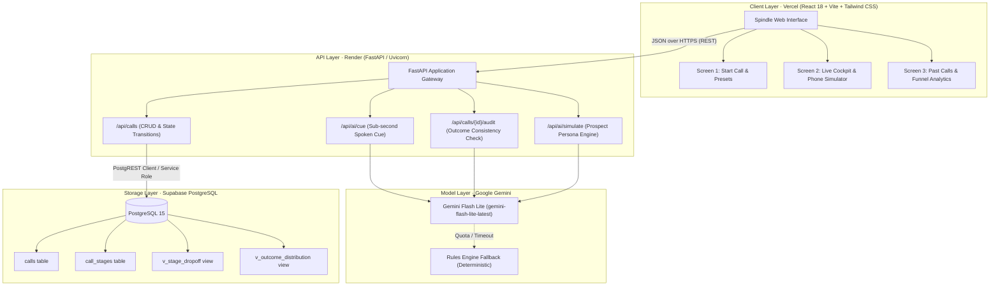
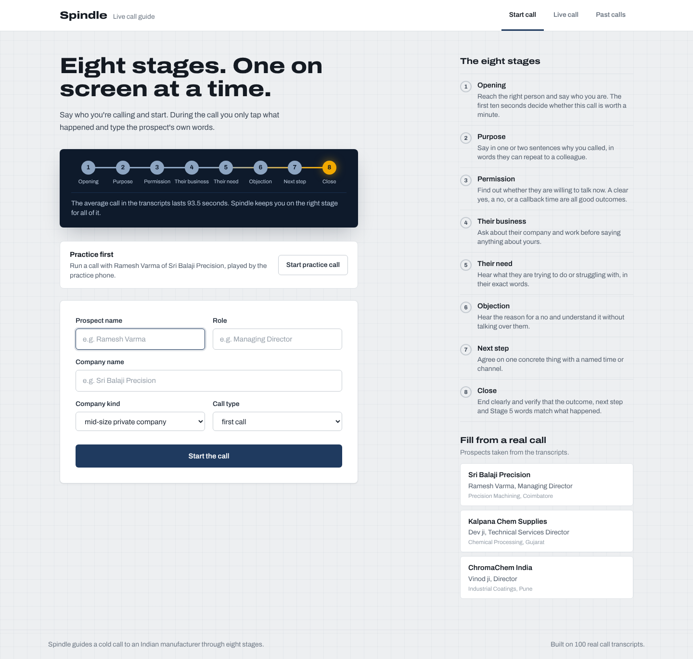
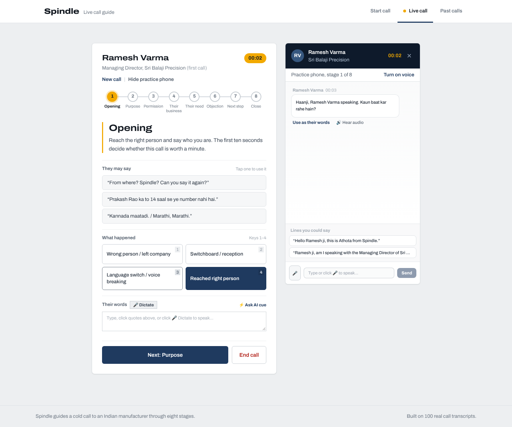
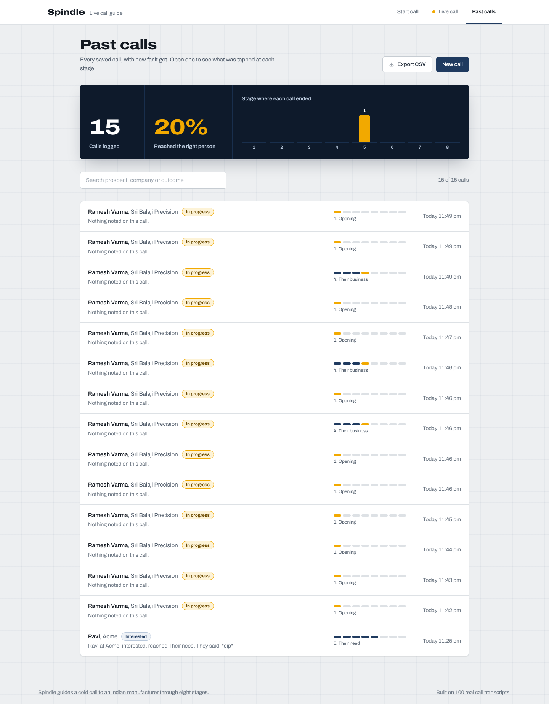
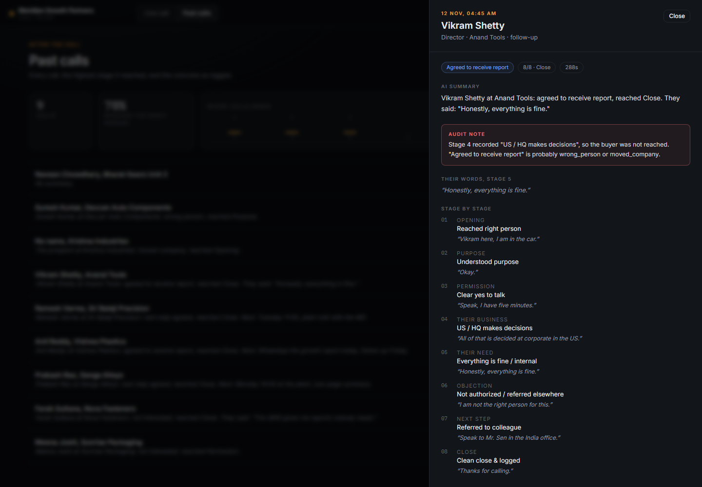

<div align="center">

# ⚡ Spindle
### The Real-Time Screen Beside the Phone for B2B Cold Calls

[](https://spindle-call.vercel.app)
[-46e3b7?style=for-the-badge&logo=render)](https://call-copilot-api.onrender.com/health)
[](https://supabase.com)
[](https://ai.google.dev)
[](https://github.com/Nitro-Builds-Yash/spindle/actions)
[](https://sainikpuri.deepthought.education/fde-hyderabad-v2)

<p align="center">
  <b>Built for the 48-Hour Forward Deployed Engineer (FDE) Hiring Challenge</b><br>
  <i>DeepThought CultureTech Ventures Pvt Ltd · Sainikpuri, Hyderabad</i>
</p>

[🚀 **Launch Live Application**](https://spindle-call.vercel.app) • [📡 **Inspect API Health**](https://call-copilot-api.onrender.com/health) • [🗄️ **View Database Schema**](schema.sql) • [🎥 **Watch 6-Min Walkthrough Video**](docs/VIDEO.md)

---

</div>

## 📑 Table of Contents
- [Executive Summary](#-executive-summary)
- [Live Deliverable URLs](#-live-deliverable-urls)
- [Empirical Analysis (100 Transcripts)](#-empirical-analysis-grounded-in-100-real-transcripts)
- [System Architecture](#️-system-architecture)
- [UI Walkthrough & Visual Tour](#-ui-walkthrough--visual-tour)
- [The 8 Call Stages](#-the-8-stages-of-an-indian-manufacturing-cold-call)
- [LLM Strategy (Google Gemini)](#-the-llm-architecture-why-google-gemini-flash-lite)
- [Database Schema (Supabase)](#️-database-architecture-schemasql)
- [Automated Testing & CI Pipeline](#-automated-testing--ci-pipeline)
- [Local Development Quickstart](#️-local-development-quickstart)
- [Submission Details](#-submission-details-for-deepthought-reviewers)

---

## 📌 Executive Summary

**Spindle** is the screen a caller keeps open beside their phone during live B2B cold calls to Indian SME manufacturing leaders. 

Cold calling Indian manufacturing managing directors (MDs, Promoters, Plant Heads) is intense: **68% of calls conclude in under two minutes** (median duration: 93.5 seconds). Callers cannot read long scripts or fill out complex forms while someone is speaking. 

Spindle solves this with a **zero-distraction 8-stage interface**:
1. **One Tap:** Fast classification of what happened at each stage (happy path pre-selected; 1-4 hotkeys supported).
2. **One Box & Hands-Free Voice Dictation (`🎤`):** Verbatim capture of the prospect's own words ("Their Words") with browser-native Speech-to-Text so callers never have to type while listening.
3. **Sub-second LLM Assistance & Audio Whisper (`🔊`):** Powered server-side by **Google Gemini Flash Lite** for mid-call spoken cues with an earpiece audio whisper option and an end-of-call **Outcome Consistency Audit** that catches human misloggings before writing to PostgreSQL.
4. **Interactive Phone Simulator with Spoken Voice:** Real-time side companion roleplaying as **Ramesh Varma** (MD, Sri Balaji Precision) with Indian English speech synthesis for realistic call practice and 1-click quote insertion.

---

## 🔗 Live Deliverable URLs

| Deliverable | Platform & Tier | Direct URL | Verified Status |
| :--- | :--- | :--- | :---: |
| **Live Web App** | **Vercel** *(Free Tier)* | [https://spindle-call.vercel.app](https://spindle-call.vercel.app) | `200 OK` · Active |
| **Backend API Health** | **Render** *(Free Web Service)* | [https://call-copilot-api.onrender.com/health](https://call-copilot-api.onrender.com/health) | `200 OK` · Active |
| **PostgreSQL Database** | **Supabase** *(Free Cloud Tier)* | `vajznvxzojiinwegtduv.supabase.co` | `Connected` · Active |
| **Active LLM Provider** | **Google AI Studio** *(Free Tier)* | `gemini-flash-lite-latest` | `Active` · Server-side |
| **GitHub Repository** | **GitHub** *(Public)* | [https://github.com/Nitro-Builds-Yash/spindle](https://github.com/Nitro-Builds-Yash/spindle) | `Public` · Main |

> [!NOTE]
> Render's free tier spins down on idle. If the backend is waking up, Spindle's frosted top banner displays a live pulsing status indicator until the service answers (`~20-30s`).

---

## 📊 Empirical Analysis: Grounded in 100 Real Transcripts

Spindle was not designed in the abstract—it was built from deep empirical analysis of the **100 rewritten cold-call transcripts** (`T001`–`T100`) across Indian SME manufacturing clusters (Coimbatore, Pune, Rajkot, Peenya, Ankleshwar).

```
   100 CALL TRANSCRIPTS (T001 - T100) AT A GLANCE
   ─────────────────────────────────────────────────────────────
   • Median Duration:       93.5 seconds (Mean: 136s, Range: 30s - 687s)
   • Calls under 2 minutes: 68%
   • Unlogged Calls:        13% abandoned with zero logged outcome
   • Decision-maker Away:   31% India arm of MNCs ("HQ / US decides")
   • Gatekeeper / Left:     13% reached wrong person or person had left
   • Immediate Question:    23% asked "What is this regarding / who is Spindle?"
   • Vague Brush-off:       41% requested "Send it on WhatsApp or email"
```

### The Core Problem: Human Outcome Mislogging
The dataset documentation explicitly notes:
> *"Outcome is what the caller logged in their system after the call. It is their word, and it does not always match what you read in the call."*

Our audit of the 100 transcripts revealed systematic mislogging patterns that corrupt CRM data:
- **`T010` & `T099`:** Logged as `agreed_to_receive_report` even though the prospect was looking for a job or an assistant gave a colleague's number.
- **`T066` & `T013`:** Logged as `not_interested` or `do_not_call` even though the person had left the company 8 years prior or was a retired non-executive director.
- **`T084`:** Logged as `do_not_call` despite the MD explicitly agreeing to a report and a Thursday follow-up call.
- **`T020`:** Logged as `do_not_call` following a standard polite decline.

**Spindle's Close Consistency Audit directly eliminates these misloggings before data enters PostgreSQL.**

---

## 🏛️ System Architecture



---

## 🖥️ UI Walkthrough & Visual Tour

### Screen 1: Start a Call (`/start`)
- **1-Click Simulation Pill:** Instantly launches an interactive 8-stage rehearsal call with Ramesh Varma (Sri Balaji Precision).
- **Manufacturing Presets:** Pre-configured prospect profiles from real transcript domains (Precision Machining in Coimbatore, Chemical Processing in Gujarat, Industrial Coatings in Pune).
- **8-Stage Overview:** Glanceable reference of all 8 call stages and their primary objectives before dialing.

<p align="center">
  
</p>

### Screen 2: Live Call Cockpit (`/live`) · *1:1 with Reading 2 Specification*
- **Header:** Call timer (`MM:SS`), prospect name, role, company name, company kind, and call type.
- **8-Stage Stepper:** Highlights current stage, progress, and stage objective in one concise sentence.
- **They May Say (3 Quotes):** Real prospect phrases extracted from transcripts to ensure the caller is never caught off guard. Clicking any quote instantly fills "Their Words".
- **What Happened (2x2 Taps):** 4 mutually exclusive outcomes with keyboard shortcut indicators `[1]`–`[4]`.
- **Their Words (Verbatim Box + 🎤 Voice Dictation):** Dedicated input for capturing exact prospect quotes (mandatory at Stage 5) with hands-free microphone dictation.
- **AI Mid-Call Assist + 🔊 Audio Whisper:** One-click button returning **one spoken sentence** (<20 words) tailored to the prospect's exact phrase, with a 1-click audio whisper directly into the caller's headset.
- **Interactive Phone Simulator with 🔊 Voice:** Real-time side companion with active audio wave visualizer, spoken prospect dialogue, conversational memory, and quick pitch buttons.

<p align="center">
  
</p>

### Screen 3: Past Calls & Audit Funnel (`/history`)
- **Outcome Funnel Analytics:** Live visualization of stage drop-offs (Stages 1–8) and connect rates.
- **1-Click CSV Export:** Export all calls, outcomes, durations, and AI summaries for CRM synchronization.
- **Real-Time Search:** Instant filtering by prospect name, company, or outcome tone.
- **Inspection Drawer:** Deep-dive modal displaying AI CRM summary, audit warnings, verbatim prospect need, and full stage progression.

<p align="center">
  
</p>

<p align="center">
  
</p>

---

## 🎯 The 8 Stages of an Indian Manufacturing Cold Call

| # | Stage | Stage Purpose | Common Prospect Reaction | Pre-pressed Tap |
|:-:|:---|:---|:---|:---|
| **01** | **Opening** | Reach the right person and say who you are within 10 seconds. | *"From where? Spindle? Can you say it again?"* | Reached right person |
| **02** | **Purpose** | State why you called in words they can repeat to a colleague. | *"What does an operational throughput report mean?"* | Understood purpose |
| **03** | **Permission** | Establish willingness to talk now, later, or over WhatsApp. | *"Call after 30 minutes; I am on the plant floor."* | Clear yes to talk |
| **04** | **Their Business** | Understand their plant setup before talking about yours. | *"We do job work for Tier-1 auto OEMs; margins are fixed."* | Confirmed business context |
| **05** | **Their Need** | Capture what they are trying to fix in **their exact words**. | *"Our CNC scrap rate spiked on the second shift."* | Named a growth need |
| **06** | **Objection** | Hear the reason for hesitation without talking over them. | *"We already have internal quality managers and ERP."* | Objection understood |
| **07** | **Next Step** | Lock down one concrete action with a named day/time. | *"Send the draft on WhatsApp; call Wednesday at 4 PM."* | Named day & time agreed |
| **08** | **Close** | Audit the outcome and ensure Stage 5 quote matches reality. | *"Chalega, done. Speak on Wednesday."* | Clean close & logged |

---

## 🤖 The LLM Architecture: Why Google Gemini Flash Lite?

Spindle calls **Google Gemini Flash Lite** (`gemini-flash-lite-latest`) over its REST API with `httpx` (no SDK), and can also use Cerebras, Mistral or OpenAI via `LLM_PROVIDER`:

1. **Bounded latency:** every AI answer has a hard ceiling (`LLM_TIMEOUT_SECONDS`, default 4 s) across all attempts, so a slow provider can never freeze a live call.
2. **Deterministic Rules Fallback:** if the key is absent, throttled, slow or unreachable, Spindle answers from a rule engine. Responses are tagged `source: rules` or `source: llm`, and `/health` shows `llm_last_error` so a bad key is visible instead of silently looking like rules mode.
3. **Zero Browser Leakage:** API keys live only in the Render backend environment and are sent in a header, never in the URL.

```python
# backend/app/llm.py (simplified)
r = httpx.post(
    f"https://generativelanguage.googleapis.com/v1beta/models/{model}:generateContent",
    headers={"x-goog-api-key": key},
    json={..., "generationConfig": {"temperature": 0.2, "maxOutputTokens": 400}},
    timeout=remaining_budget,   # shrinks with each attempt
)
```

## 🔒 Security

- **Access token:** set `SPINDLE_ACCESS_TOKEN` on the backend (the Render blueprint generates one). Every `/api/*` route except `/api/content` then requires `Authorization: Bearer <token>`. Callers type the token into the app once; it is kept in their browser and never built into the frontend bundle. `/health` stays public for uptime checks.
- **CORS:** `ALLOWED_ORIGINS` no longer defaults to `*`. Unset, only the local Vite dev server is allowed; in production set it to your Vercel URL.
- **CSV export:** cells starting with `=`, `+`, `-` or `@` are prefixed with `'` so spreadsheet apps never execute them as formulas.
- **Health warnings:** `/health` lists misconfigurations, e.g. SQLite on Render (wiped on every restart) or a missing access token.

---

## 🗄️ Database Architecture (`schema.sql`)

Spindle connects to a production **Supabase PostgreSQL** instance with Row Level Security (RLS) enabled and zero ORM overhead:

- **`calls` table:** Holds top-level metadata (`prospect_name`, `company_name`, `company_kind`, `call_type`, `outcome`, `duration_seconds`, `summary`, `audit_warning`).
- **`call_stages` table:** Normalized stage logs with `UNIQUE (call_id, stage_number)` constraint ensuring re-taps update in place without duplicating records.
- **`v_stage_dropoff` view:** Pre-computed aggregation of where calls drop off across stages 1 through 8.
- **`v_outcome_distribution` view:** Real-time distribution of call outcomes across the entire database.

---

## 🦀 Rust engine (WebAssembly)

`engine/` is a Rust crate with Spindle's call rules: reading which stage the prospect's words point to, the fallback cue, the close audit, the manager summary and the suggested outcome. CI compiles it to WebAssembly (`frontend/src/engine/pkg`) and the browser runs it directly, so:

- **Cues are instant and work offline.** Asking for a cue shows the on-device line at once; the model's answer replaces it when it arrives.
- **Live stage read.** As the prospect's words are typed or dictated, Spindle says "Sounds like *Objection* (stage 6)" with a one-tap jump.
- **The pre-close check is instant**, also offline; the server's check (which may use the model) still has the final word.

The rules exist in Python too (for the API). `engine/tests/parity.rs` replays 3,700+ cases generated from the Python and JavaScript (`engine/fixtures/gen_python.py`, `gen_js.mjs`), so the three can't drift: CI fails if a rule changes in one place only.

```bash
cd engine && cargo test          # parity + unit tests
wasm-pack build --release --target web --out-dir ../frontend/src/engine/pkg --no-pack
```

If the WebAssembly build is missing, the app falls back to the server's rules with no change in behaviour.

## 🧰 Working features for a calling team

- **Call list:** import a CSV of prospects (needs `name` and `company` columns; `role`, `kind`, `phone` optional) on the Start screen and work through it top to bottom. The list stays in that browser.
- **Follow-ups:** when an outcome means someone should call back, the close dialog asks for a callback time. Past calls lists them as overdue, today or upcoming, with **Add to calendar** (`.ics`), **Mark done** and **Call now**.
- **Offline taps:** if the connection drops mid-call (or the free Render server is waking up), taps are saved in the browser and sent when it's back. A call is never closed while taps are still waiting.
- **Abandoned calls:** a call left open with no activity for `ABANDON_AFTER_MINUTES` (default 30) is closed automatically and kept out of the drop-off chart and connect rate.
- **Dictation → cue:** when dictation stops, Spindle asks for the next line automatically.

### Operations settings (backend)

| Variable | Default | What it does |
|---|---|---|
| `SPINDLE_ACCESS_TOKEN` | unset | Shared token for `/api/*` |
| `ALLOWED_ORIGINS` | local dev only | Frontend URLs allowed by CORS |
| `LLM_TIMEOUT_SECONDS` | `4` | Ceiling for one AI answer |
| `AI_RATE_PER_MINUTE` | `30` | AI requests per client per minute (429 after) |
| `ABANDON_AFTER_MINUTES` | `30` | When an untouched open call is closed |
| `SENTRY_DSN` / `VITE_SENTRY_DSN` | unset | Optional error tracking, backend / frontend |

### Database migrations

New installs: run `schema.sql`. Existing Supabase projects: also run `migrations/002_follow_ups.sql` once (adds the follow-up columns). Until then follow-ups are hidden and `/health` shows a warning; everything else works.

## 🧪 Automated Testing & CI Pipeline

- **Backend** (`backend/tests/test_api.py`, pytest): call lifecycle, audit, CSV export and formula escaping, access token, CORS, LLM deadline and fallback, AI rate limit, abandoned-call sweep, follow-ups and the calendar file, paging, and Supabase paging/chunking against a fake PostgREST.
- **Frontend** (`frontend/src/test`, Vitest + Testing Library): CSV parsing, call helpers, the offline outbox, the stage rail, tap grid and call list.
- **Lint and types:** ESLint (React + hooks rules) and `tsc` over the typed API client (`src/api.ts`).

```bash
cd backend && pytest -q
cd frontend && npm run lint && npm run typecheck && npm test && npm run build
```

GitHub Actions runs all of it, plus `npm audit`, on every push and pull request to `main`:
[](https://github.com/Nitro-Builds-Yash/spindle/actions)

---

## 🛠️ Local Development Quickstart

You can run the entire Spindle stack locally in under 3 minutes with zero cloud accounts (falls back to local SQLite and deterministic rules engine):

### 1. Clone & Set Up Backend
```bash
git clone https://github.com/Nitro-Builds-Yash/spindle.git
cd spindle/backend

# Create virtual environment
python -m venv .venv
# On Windows:
.venv\Scripts\activate
# On Linux/macOS:
# source .venv/bin/activate

# Install dependencies
pip install -r requirements.txt

# Start backend server
uvicorn app.main:app --reload --port 8000
```
Backend will be live at `http://localhost:8000` (`/health` & `/docs` available).

### 2. Set Up Frontend
```bash
cd ../frontend

# Install dependencies
npm install

# Start Vite dev server
npm run dev
```
Open `http://localhost:5173` in your browser.

---

## 📦 Submission Details for DeepThought Reviewers

- **Applicant Name:** Athota Yashwanth
- **Role:** Forward Deployed Engineer (FDE) · Hyderabad
- **Company:** DeepThought CultureTech Ventures Pvt Ltd
- **CEO WhatsApp Contact Ready:** Yes, pre-formatted message generated with all live links.

---

<div align="center">
  <b>Spindle · Built with speed, rigor, and first-principles business ontology.</b><br>
  <sub>React 18 · Vite · Tailwind CSS · FastAPI · Supabase PostgreSQL · Google Gemini Flash Lite</sub>
</div>
