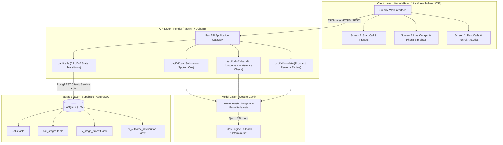

<div align="center">

# ⚡ Spindle
### The Real-Time Screen Beside the Phone for B2B Cold Calls

[](https://meridian-cold-call-copilot.vercel.app)
[-46e3b7?style=for-the-badge&logo=render)](https://call-copilot-api.onrender.com/health)
[](https://supabase.com)
[](https://ai.google.dev)
[](https://sainikpuri.deepthought.education/fde-hyderabad-v2)

<p align="center">
  <b>Built for the 48-Hour Forward Deployed Engineer (FDE) Hiring Challenge</b><br>
  <i>DeepThought CultureTech Ventures Pvt Ltd · Sainikpuri, Hyderabad</i>
</p>

[🚀 **Launch Live Application**](https://meridian-cold-call-copilot.vercel.app) • [📡 **Inspect API Health**](https://call-copilot-api.onrender.com/health) • [🗄️ **View Database Schema**](schema.sql) • [🎥 **Watch 6-Min Walkthrough Video**](docs/VIDEO.md)

---

</div>

## 📌 Executive Summary

**Spindle** is the screen a caller keeps open beside their phone during live B2B cold calls to Indian SME manufacturing leaders. 

Cold calling Indian manufacturing managing directors (MDs, Promoters, Plant Heads) is intense: **68% of calls conclude in under two minutes** (median duration: 93.5 seconds). Callers cannot read long scripts or fill out complex forms while someone is speaking. 

Spindle solves this with a **zero-distraction 8-stage interface**:
1. **One Tap:** Fast classification of what happened at each stage (happy path pre-selected; 1-4 hotkeys supported).
2. **One Box:** Verbatim capture of the prospect's own words ("Their Words").
3. **Sub-second LLM Assistance:** Powered server-side by **Google Gemini Flash Lite** for mid-call spoken cues and an end-of-call **Outcome Consistency Audit** that catches human misloggings before writing to PostgreSQL.
4. **Interactive Phone Simulator:** Real-time side companion roleplaying as **Ramesh Varma** (MD, Sri Balaji Precision) for realistic call practice and 1-click quote insertion.

---

## 🔗 Live Deliverable URLs

| Deliverable | Platform & Tier | Direct URL | Verified Status |
| :--- | :--- | :--- | :---: |
| **Live Web App** | **Vercel** *(Free Tier)* | [https://meridian-cold-call-copilot.vercel.app](https://meridian-cold-call-copilot.vercel.app) | `200 OK` · Active |
| **Backend API Health** | **Render** *(Free Web Service)* | [https://call-copilot-api.onrender.com/health](https://call-copilot-api.onrender.com/health) | `200 OK` · Active |
| **PostgreSQL Database** | **Supabase** *(Free Cloud Tier)* | `vajznvxzojiinwegtduv.supabase.co` | `Connected` · Active |
| **Active LLM Provider** | **Google AI Studio** *(Free Tier)* | `gemini-flash-lite-latest` | `Active` · Server-side |
| **GitHub Repository** | **GitHub** *(Public)* | [https://github.com/Nitro-Builds-Yash/spindle](https://github.com/Nitro-Builds-Yash/spindle) | `Public` · Main |

> [!NOTE]
> Render's free tier spins down on idle. If the backend is waking up, Spindle's frosted top banner displays a live pulsing status indicator until the service answers (`~20-30s`).

---

## 📊 Empirical Analysis: Grounded in 100 Real Transcripts

Spindle was not designed in the abstract—it was built from deep empirical analysis of the **100 rewritten cold-call transcripts** (`T001`–`T100`) across Indian SME manufacturing clusters (Coimbatore, Pune, Rajkot, Peenya, Ankleshwar).

```
   100 CALL TRANSCRIPTS (T001 - T100) AT A GLANCE
   ─────────────────────────────────────────────────────────────
   • Median Duration:       93.5 seconds (Mean: 136s, Range: 30s - 687s)
   • Calls under 2 minutes: 68%
   • Unlogged Calls:        13% abandoned with zero logged outcome
   • Decision-maker Away:   31% India arm of MNCs ("HQ / US decides")
   • Gatekeeper / Left:     13% reached wrong person or person had left
   • Immediate Question:    23% asked "What is this regarding / what is Meridian/Spindle?"
   • Vague Brush-off:       41% requested "Send it on WhatsApp or email"
```

### The Core Problem: Human Outcome Mislogging
The dataset documentation explicitly notes:
> *"Outcome is what the caller logged in their system after the call. It is their word, and it does not always match what you read in the call."*

Our audit of the 100 transcripts revealed systematic mislogging patterns that corrupt CRM data:
- **`T010` & `T099`:** Logged as `agreed_to_receive_report` even though the prospect was looking for a job or an assistant gave a colleague's number.
- **`T066` & `T013`:** Logged as `not_interested` or `do_not_call` even though the person had left the company 8 years prior or was a retired non-executive director.
- **`T084`:** Logged as `do_not_call` despite the MD explicitly agreeing to a report and a Thursday follow-up call.
- **`T020`:** Logged as `do_not_call` following a standard polite decline.

**Spindle's Close Consistency Audit directly eliminates these misloggings before data enters PostgreSQL.**

---

## 🏛️ System Architecture



---

## 🖥️ The 3-Screen Workflow

### Screen 1: Start a Call (`/start`)
- **Interactive Simulation Pill:** 1-click launch of a live 8-stage rehearsal call with Ramesh Varma (Sri Balaji Precision).
- **Manufacturing Presets:** Pre-configured prospect profiles from real transcript domains (Precision Machining in Coimbatore, Chemical Processing in Gujarat, Industrial Coatings in Pune).
- **8-Stage Overview:** Glanceable reference of all 8 call stages and their primary objectives before dialing.
- **Active Call Banner:** Seamless resumption if a call is already in progress.

### Screen 2: Live Call Cockpit (`/live`) · *1:1 with Reading 2 Specification*
- **Header:** Call timer (`MM:SS`), prospect name, role, company name, company kind, and call type.
- **8-Stage Stepper:** Highlights current stage, progress, and stage objective in one concise sentence.
- **They May Say (3 Quotes):** Real prospect phrases extracted from transcripts to ensure the caller is never caught off guard.
- **What Happened (2x2 Taps):** 4 mutually exclusive outcomes for the stage. Keyboard shortcuts `1`–`4` for touch-free logging.
- **Their Words (Verbatim Box):** Dedicated input for capturing exact prospect quotes (mandatory at Stage 5). Includes quick quote insertion chips.
- **AI Mid-Call Assist:** One-click button returning **one spoken sentence** (<20 words) tailored to the prospect's exact phrase.
- **Interactive Phone Simulator:** Real-time side companion with audio wave pulse, conversational memory, and quick pitch buttons.
- **Navigation Controls:** `Next Stage →`, `Close Call →`, and `End Call` on every stage (allowing clean exits at Stage 1).

### Screen 3: Past Calls & Audit Funnel (`/history`)
- **Outcome Funnel Analytics:** Live visualization of stage drop-offs (Stages 1–8) and connect rates.
- **Call Ledger:** Tabular view of all past calls stored in Supabase with outcome pills, verbatim notes, and audit badges.
- **Inspection Drawer:** Deep-dive modal displaying AI CRM summary, audit warnings, verbatim prospect need, and full stage progression.

---

## 🎯 The 8 Stages of an Indian Manufacturing Cold Call

| # | Stage | Stage Purpose | Common Prospect Reaction | Pre-pressed Tap |
|:-:|:---|:---|:---|:---|
| **01** | **Opening** | Reach the right person and say who you are within 10 seconds. | *"From where? Spindle? Can you say it again?"* | Reached right person |
| **02** | **Purpose** | State why you called in words they can repeat to a colleague. | *"What does an operational throughput report mean?"* | Understood purpose |
| **03** | **Permission** | Establish willingness to talk now, later, or over WhatsApp. | *"Call after 30 minutes; I am on the plant floor."* | Clear yes to talk |
| **04** | **Their Business** | Understand their plant setup before talking about yours. | *"We do job work for Tier-1 auto OEMs; margins are fixed."* | Confirmed business context |
| **05** | **Their Need** | Capture what they are trying to fix in **their exact words**. | *"Our CNC scrap rate spiked on the second shift."* | Named a growth need |
| **06** | **Objection** | Hear the reason for hesitation without talking over them. | *"We already have internal quality managers and ERP."* | Objection understood |
| **07** | **Next Step** | Lock down one concrete action with a named day/time. | *"Send the draft on WhatsApp; call Wednesday at 4 PM."* | Named day & time agreed |
| **08** | **Close** | Audit the outcome and ensure Stage 5 quote matches reality. | *"Chalega, done. Speak on Wednesday."* | Clean close & logged |

---

## 🤖 The LLM Architecture: Why Google Gemini Flash Lite?

Spindle integrates **Google Gemini Flash Lite** (`gemini-flash-lite-latest`) via the official Google GenAI SDK:

1. **Sub-second Response Times:** Ultra-low latency is required so caller flow is never interrupted mid-conversation.
2. **Deterministic Rules Fallback:** If the LLM key is absent, throttled, or unreachable, Spindle smoothly switches to an in-memory deterministic rule engine (`rules-fallback`). The UI explicitly tags answers with `source: rules` or `source: llm` for full transparency.
3. **Zero Browser Leakage:** API keys are secured exclusively in the Render backend environment. No client-side exposure.

```python
# Server-side Gemini invocation in backend/app/llm.py
client = genai.Client(api_key=api_key)
response = client.models.generate_content(
    model="gemini-flash-lite-latest",
    contents=prompt,
    config=types.GenerateContentConfig(
        max_output_tokens=80,
        temperature=0.2,  # Low temperature for precise consistency evaluation
    ),
)
```

---

## 🗄️ Database Architecture (`schema.sql`)

Spindle connects to a production **Supabase PostgreSQL** instance with Row Level Security (RLS) enabled and zero ORM overhead:

- **`calls` table:** Holds top-level metadata (`prospect_name`, `company_name`, `company_kind`, `call_type`, `outcome`, `duration_seconds`, `summary`, `audit_warning`).
- **`call_stages` table:** Normalized stage logs with `UNIQUE (call_id, stage_number)` constraint ensuring re-taps update in place without duplicating records.
- **`v_stage_dropoff` view:** Pre-computed aggregation of where calls drop off across stages 1 through 8.
- **`v_outcome_distribution` view:** Real-time distribution of call outcomes across the entire database.

---

## 🛠️ Local Development Quickstart

You can run the entire Spindle stack locally in under 3 minutes with zero cloud accounts (falls back to local SQLite and deterministic rules engine):

### 1. Clone & Set Up Backend
```bash
git clone https://github.com/Nitro-Builds-Yash/spindle.git
cd spindle/backend

# Create virtual environment
python -m venv .venv
# On Windows:
.venv\Scripts\activate
# On Linux/macOS:
# source .venv/bin/activate

# Install dependencies
pip install -r requirements.txt

# Start backend server
uvicorn app.main:app --reload --port 8000
```
Backend will be live at `http://localhost:8000` (`/health` & `/docs` available).

### 2. Set Up Frontend
```bash
cd ../frontend

# Install dependencies
npm install

# Start Vite dev server
npm run dev
```
Open `http://localhost:5173` in your browser.

---

## 📦 Submission Details for DeepThought Reviewers

- **Applicant Name:** Athota Yashwanth
- **Role:** Forward Deployed Engineer (FDE) · Hyderabad
- **Company:** DeepThought CultureTech Ventures Pvt Ltd
- **CEO WhatsApp Contact Ready:** Yes, pre-formatted message generated with all live links.

---

<div align="center">
  <b>Spindle · Built with speed, rigor, and first-principles business ontology.</b><br>
  <sub>React 18 · Vite · Tailwind CSS · FastAPI · Supabase PostgreSQL · Google Gemini Flash Lite</sub>
</div>
